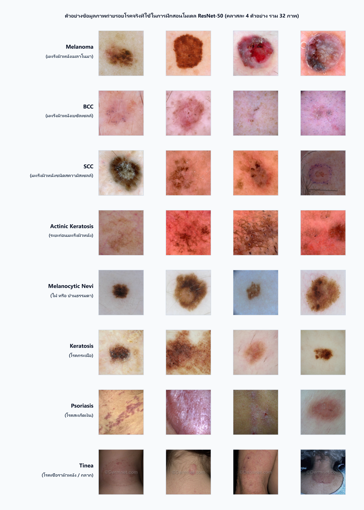
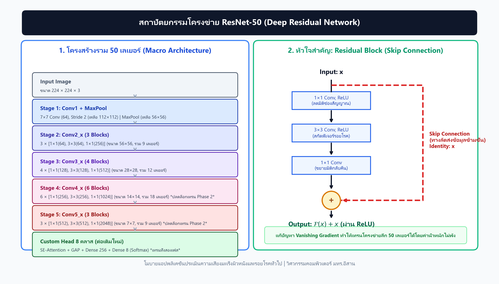
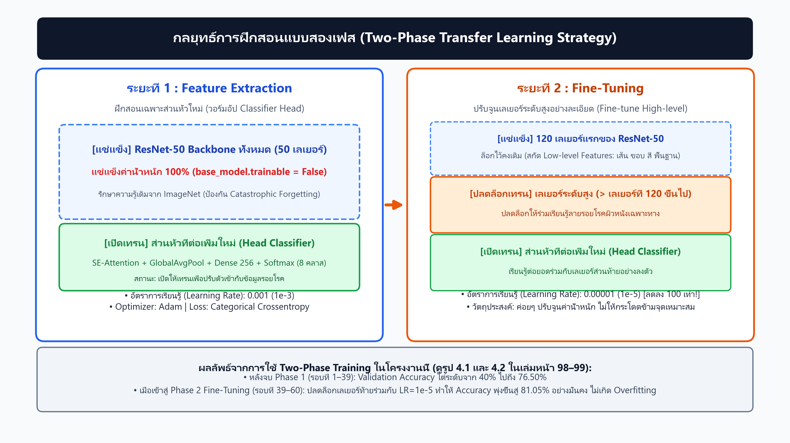
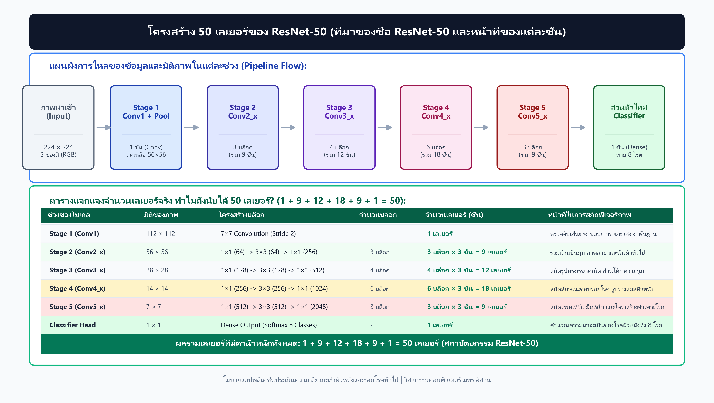
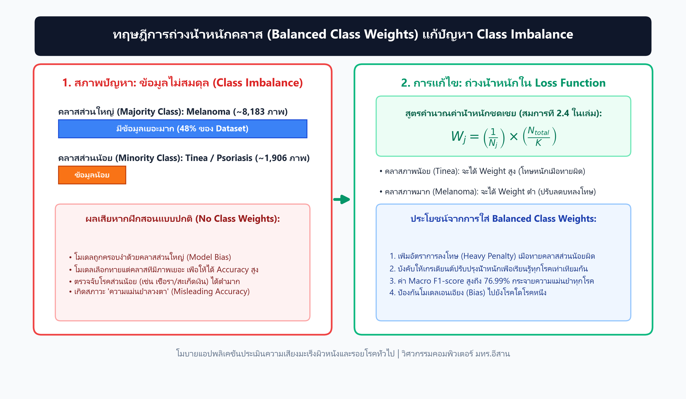
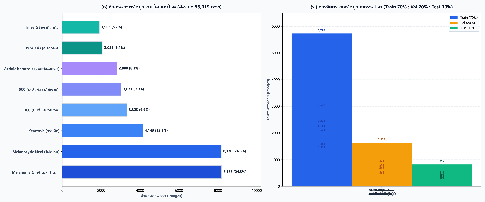
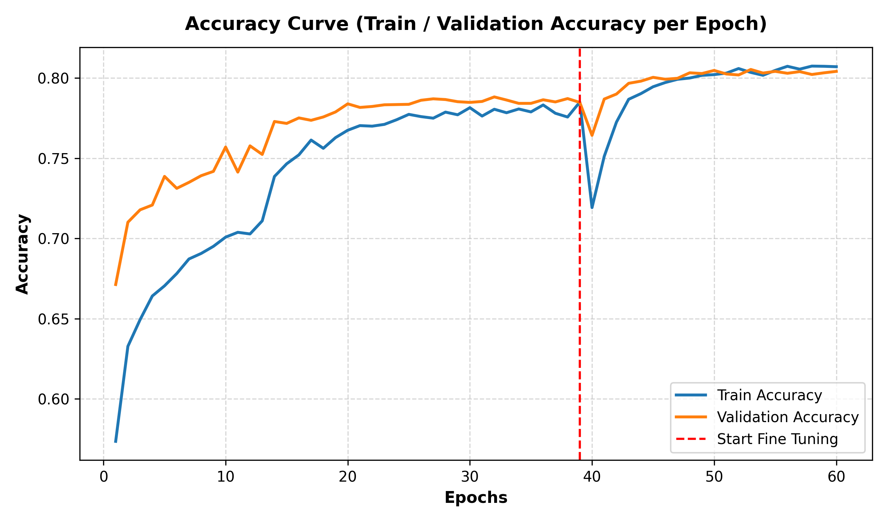
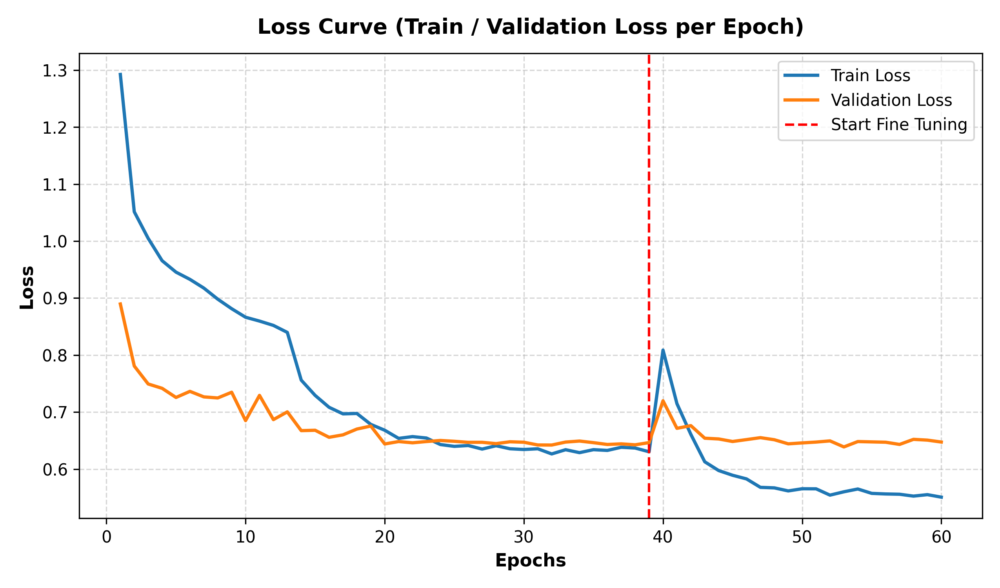
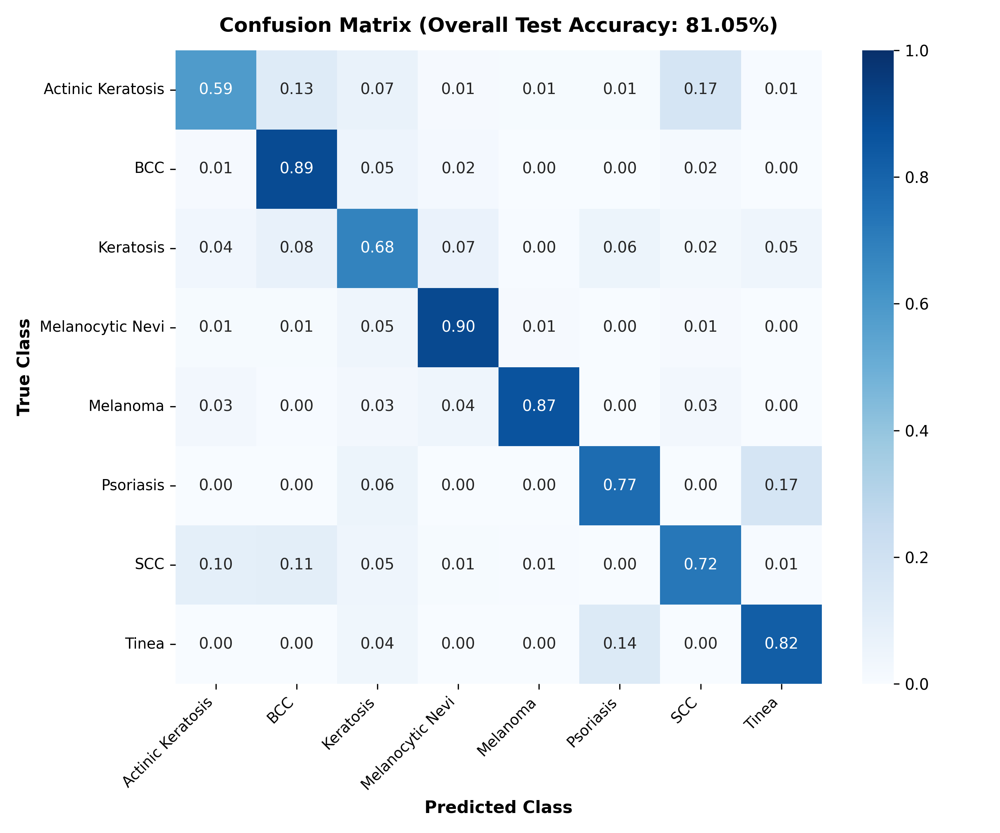
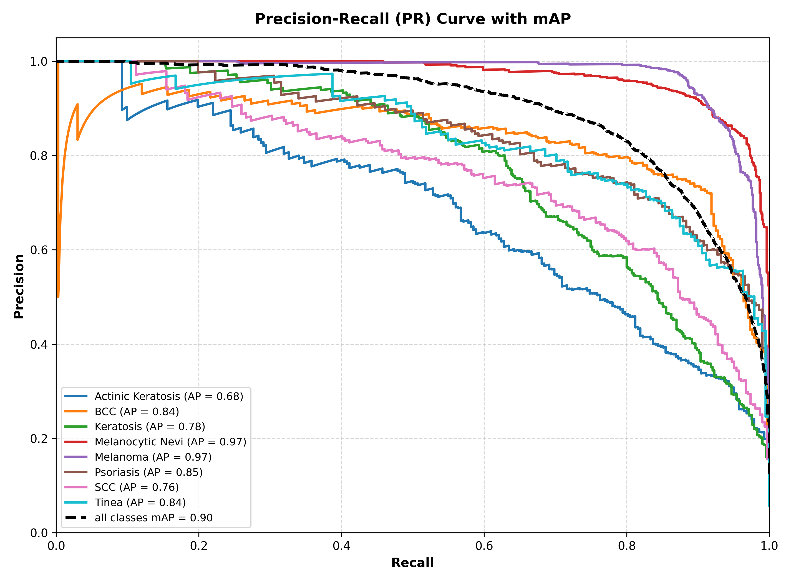

# 🩺 Skin Lesion & Skin Cancer Classification (ResNet50 + Gradio)

[](https://www.python.org/)
[](https://www.tensorflow.org/)
[](https://gradio.app/)
[](LICENSE)

ระบบปัญญาประดิษฐ์จำแนกความเสี่ยงมะเร็งผิวหนังและรอยโรคผิวหนังทั่วไป 8 ชนิด โดยใช้แบบจำลองสถาปัตยกรรม **ResNet50** ผ่านเทคนิค **Transfer Learning & Fine-Tuning** พร้อมระบบส่วนติดต่อผู้ใช้ผ่านเว็บแอปพลิเคชันด้วย **Gradio** และรองรับการแปลงโมเดลเป็น **TensorFlow Lite (TFLite)** สำหรับนำไปใช้งานบนโมบายแอปพลิเคชัน (Flutter)

---

## 📌 รอยโรคและโรคผิวหนังเป้าหมาย 8 กลุ่ม (8 Target Classes)

โมเดลได้รับการฝึกฝนเพื่อตรวจจับและจำแนกรอยโรคผิวหนังทั้งกลุ่มเสี่ยงมะเร็งและโรคผิวหนังทั่วไป:

1. **Actinic Keratosis** - ระยะก่อนมะเร็งผิวหนัง
2. **Basal Cell Carcinoma (BCC)** - มะเร็งผิวหนังชนิดเบเซลเซลล์
3. **Keratosis** - โรคกระเนื้อ / ตุ่มเนื้อนูน
4. **Melanocytic Nevi** - ไฝ หรือ ปานธรรมดา
5. **Melanoma** - มะเร็งผิวหนังเมลาโนมา (ชนิดร้ายแรง)
6. **Psoriasis** - โรคสะเก็ดเงิน
7. **Squamous Cell Carcinoma (SCC)** - มะเร็งผิวหนังชนิดสความัสเซลล์
8. **Tinea** - โรคเชื้อราที่ผิวหนัง / กลาก เกลื้อน

<div align="center">
  
  <p><em>ตัวอย่างภาพถ่ายรอยโรคผิวหนังทั้ง 8 กลุ่มที่ใช้ในชุดข้อมูล</em></p>
</div>

---

## 🧠 สถาปัตยกรรมโมเดลและขั้นตอนการเรียนรู้ (Model Architecture)

แบบจำลองพัฒนาบนพื้นฐานของ **ResNet50 (Residual Network)** ซึ่งมีความสามารถในการลดปัญหา Vanishing Gradient ในการเทรนโครงข่ายเชิงลึก:

- **Backbone:** ResNet50 (Pretrained on ImageNet)
- **Feature Extraction & Attention:** เสริมด้วย Attention Mechanism และ Batch Normalization เพื่อโฟกัสรอยโรคผิวหนังได้อย่างแม่นยำ
- **Training Strategy:** การเทรนแบ่งเป็น 2 ระยะ (Two-Phase Training)
  - *Phase 1:* Freeze ฐาน ResNet50 เพื่อเทรน Top Classification Head
  - *Phase 2:* Fine-Tuning ปรับปรุงค่าน้ำหนักของ Layer ส่วนท้าย
- **Handling Class Imbalance:** ใช้ Class Weights เพื่อชดเชยความไม่สมดุลของจำนวนข้อมูลในแต่ละคลาส

| สถาปัตยกรรมโมเดล | กระบวนการ Two-Phase Training |
|:---:|:---:|
|  |  |

| การแบ่งชั้นเลเยอร์ของ ResNet50 | เทคนิค Class Weights จัดการ Data Imbalance |
|:---:|:---:|
|  |  |

---

## 📊 ประสิทธิภาพและการประเมินผล (Model Evaluation)

<div align="center">
  
</div>

### กราฟการฝึกฝนและวัดผลความแม่นยำ (Metrics & Confusion Matrix)

| Accuracy Curve | Loss Curve |
|:---:|:---:|
|  |  |

| Confusion Matrix | Precision-Recall Curve (PR Curve) |
|:---:|:---:|
|  |  |

---

## 💻 เว็บแอปพลิเคชัน Gradio (`app.py`)

ในโปรเจกต์มีระบบทดสอบผ่านเว็บแอปพลิเคชันที่พัฒนาด้วย Gradio ซึ่งมาพร้อมความสามารถ:
- อัปโหลดหรือถ่ายภาพรอยโรค
- เครื่องมือ Crop & Zoom เพื่อปรับโฟกัสบริเวณรอยโรค
- ประมวลผลและแสดงความน่าจะเป็น (Probability Distribution) พร้อมระบุระดับความเสี่ยง
- ส่งออกผลการวิเคราะห์เป็นรายงานไฟล์ Excel (`.xlsx`)

---

## 🚀 การติดตั้งและเริ่มใช้งาน (Getting Started)

### 1. Clone Repository
```bash
git clone https://github.com/Timemagodji/Projectjob.git
cd Projectjob
```

### 2. สร้าง Virtual Environment และติดตั้ง Dependencies
```bash
python -m venv .venv
# บน Windows
.venv\Scripts\activate
# บน macOS/Linux
source .venv/bin/activate

pip install -r requirements.txt
```

### 3. รันเว็บแอปพลิเคชัน
```bash
python app.py
```
เปิดเว็บเบราว์เซอร์ไปที่ `http://127.0.0.1:7860`

---

## 📱 การแปลงโมเดลสำหรับ Mobile (TFLite)

สำหรับการนำไปใช้งานบนอุปกรณ์พกพา เช่น สมาร์ตโฟน (Flutter / Android / iOS):
```bash
python convert_tflite.py
```
สคริปต์จะแปลงโมเดล Keras ให้อยู่ในรูป `.tflite` (Modelv3.tflite) เพื่อความเร็วในการทำ Inference แบบ On-Device

---

## 📂 โครงสร้างโปรเจกต์ (Project Structure)

```text
├── app.py                             # Gradio Web Application สำหรับทดสอบและทำนายผล
├── train.py / train2.py / train7.py   # สคริปต์ฝึกสอนโมเดล ResNet50
├── split_dataset.py                   # สคริปต์แบ่งข้อมูล Train/Val/Test
├── eval_model.py                      # สคริปต์ประเมินผลและสร้างกราฟวัดผล
├── convert_tflite.py                  # สคริปต์แปลงโมเดลเป็น TensorFlow Lite
├── generate_*.py                      # สคริปต์สร้างแผนภาพสถาปัตยกรรมและกราฟสรุปผล
├── class_indices.json / labels.txt    # ดัชนีและป้ายกำกับของแต่ละคลาสโรค
├── dataset_samples_for_presentation/  # ตัวอย่างภาพถ่ายรอยโรคแต่ละคลาส
├── test_results_*.xlsx                # ตารางผลการทดสอบแยกตามชนิดโรค
├── requirements.txt                   # รายการไลบรารีที่จำเป็น
└── README.md                          # เอกสารแนะนำโปรเจกต์
```

---

## 👨‍💻 พัฒนาโดย (Contributors)
- **Time (ธาม สรรพวุธ)** - [GitHub Profile](https://github.com/Timemagodji)
- สาขาวิชาวิศวกรรมคอมพิวเตอร์ มหาวิทยาลัยเทคโนโลยีราชมงคลอีสาน (RMUTI)
